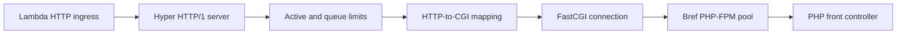

# Architecture

Rust provides the HTTP/FastCGI gateway and supervises Bref PHP-FPM. The PHP
distribution and extensions remain separate bundled files. Each FPM child runs
one ordinary PHP request at a time; the pool provides concurrency.

## Startup

```text
AWS starts managed Node 24 (index.js)
  -> php -n compat/bootstrap.php    validate BREF_WEB_* settings, derive paths,
                                    write /tmp/bref-web/php-fpm.conf
  -> php compat/configure.php       with application INI loaded: write the
                                    runtime INI (application values win)
  -> php compat/init.php            Composer autoload, bref-ssm: secrets,
                                    BREF_WEB_INIT_FILE, beforeStartup
  -> exec the Rust gateway          start PHP-FPM, wait for it, listen on
                                    AWS_LAMBDA_HTTP_ENDPOINT
```

This mirrors Bref's own layering: a minimal launcher (Bref's is a Bash loop;
Web Functions require Node) starts PHP, and the logic lives in PHP. Each step
`exec`s the next, so environment changes made during initialization, including
resolved secrets, reach the gateway without files, logs or IPC.

Node stays alive as the outer supervisor. It checks readiness, detects an
unexpected gateway exit and forwards shutdown signals. HTTP requests do not pass
through Node. Initialization finishes before application traffic is accepted.

## Request path



Rust uses Hyper for HTTP and a single-thread Tokio runtime for asynchronous I/O,
timers and process events. A small owned FastCGI codec uses a fresh connection for
each request; it does not multiplex several PHP requests onto one connection.

The gateway admits work before collecting the request body. Default limits are
twelve active PHP reservations and four queued requests, with a one-second queue
wait. Bodies are fully buffered within the configured limit. CGI parameters carry
per-request metadata; request IDs are not written into shared process environment.
Responses stream through bounded buffers with backpressure.

A backend task owns its reservation independently of the frontend response.
Disconnecting or reaching an HTTP deadline does not prove PHP stopped. The task
keeps accounting for backend work until FastCGI completion or termination is
confirmed. The confirmation deadline is the later of the HTTP deadline and the
latest time FPM can end an overrunning worker, plus two seconds. FPM checks its
script deadline only on a heartbeat of a third of that deadline, so it ends an
overrun up to a third late: 28 s becomes up to 37.3 s, and the confirmation
deadline is then 39.3 s. This allows a blocked frontend to close, backend output
to drain and a late FPM termination to land before declaring completion
unconfirmed.

The connection driver independently enforces the HTTP deadline plus a fixed
100 ms grace for flushing terminal responses such as 408/504. It drops the whole
Hyper connection and socket at that cutoff, even when a write is blocked and no
response-body frame is being polled. Each dispatched HTTP/1 keepalive request
refreshes the deadline. The last deadline also bounds an idle connection after
its response. Before a request is dispatched, Hyper's header-read timer applies
the same HTTP deadline plus grace: a new connection that sends nothing,
incomplete request headers, and the wait for the next keepalive request.

A failed `accept()` for one pending connection is retried. Descriptor, buffer or
memory exhaustion pauses accepting for 100 ms, while signals, retirement and FPM
exit are still handled, instead of stopping a runtime whose existing connections
will free those resources. Any other accept error stops the runtime.

## Request mapping

The gateway sends every application request to the PHP file selected by
`BREF_WEB_SCRIPT_FILENAME` (default `/var/task/public/index.php`).
`BREF_WEB_DOCUMENT_ROOT` defaults to `/var/task/public`.

`SCRIPT_NAME` and `DOCUMENT_URI` describe the selected front controller's path
relative to the document root. For example, `/var/task/public/admin/front.php`
with document root `/var/task/public` produces `/admin/front.php`. The document
root is matched by path components, so `/var/task/public-other` is not treated
as part of `/var/task/public`.

If the controller is outside the document root, the gateway uses its basename
at the URL root: `/var/task/controllers/app.php` produces `/app.php`. This is a
metadata convention for a fixed front controller; it does not expose filesystem
paths or add a static-file route. Path derivation is lexical and does not resolve
symlinks. `SCRIPT_FILENAME` remains the explicitly configured filesystem path.

`REQUEST_URI` retains the incoming escaped path and raw query. `PATH_INFO`
retains the existing decoded incoming path behavior. Changing the controller
does not change these request fields.

### Request metadata

Address variables follow Bref's FPM runtime: `REMOTE_ADDR` and `SERVER_ADDR`
are `127.0.0.1`, and `REMOTE_PORT` is the integer prefix of `X-Forwarded-Port`
(80 when absent). Bref's documented Symfony setting
`trusted_proxies: '127.0.0.1'` therefore keeps trusting `X-Forwarded-*`; the
client address is `X-Forwarded-For` as supplied by the ingress. Applications
should trust those headers only behind Lambda's ingress. `SERVER_NAME` is the `Host` header
without its port (and without IPv6 brackets); `HTTP_HOST` keeps the original
value. `SERVER_PORT` remains `443` for Lambda's TLS-terminated ingress.

Request header names containing `_` are not passed to PHP. `X-Real-IP` and
`X_Real_IP` would both become `HTTP_X_REAL_IP`, and PHP keeps the last duplicate,
so an underscore variant that an upstream proxy does not recognise could
otherwise replace a header that proxy set. nginx drops these names by default.

`SERVER_PORT` follows `X-Forwarded-Port` like Bref, but defaults to 443 rather
than Bref's 80 because the ingress is HTTPS. A body without `Content-Type` is sent
as `application/x-www-form-urlencoded`, as Bref does, and the content headers
also appear as `HTTP_CONTENT_TYPE`/`HTTP_CONTENT_LENGTH`. `X-Amzn-Trace-Id`
becomes `_X_AMZN_TRACE_ID`.

`LAMBDA_REQUEST_ID` comes from `lambda-web-request-id` only when that header is
1–256 characters from `[A-Za-z0-9._:-]`; anything else gets a generated
`local-<uuid>`. The value is written unquoted into FPM's space-separated access
log, so other characters could forge log fields.

Run focused tests with `cargo test --locked cgi::tests`, or all unit tests with
`cargo test --locked`.

## Process lifecycle

Rust starts FPM in a dedicated process group. FPM enforces its per-worker request
timeout and replenishes failed workers. A single worker failure does not require
restarting the entire pool. An unexpected FPM master exit stops the Rust runtime.

Unconfirmed backend completion triggers controlled retirement: admission closes,
queued requests wake without dispatching new PHP work, and the listener stops.
Already active requests have the configured shutdown grace to finish. Rust then
terminates its FPM process group, closes remaining connections and exits nonzero;
Node detects that exit and stops too. The runtime relies on the platform or
operator to start a replacement, rather than remaining alive serving 503s or
restarting the PHP pool in place. On AWS, at most one request per retirement
received 503 `Runtime.Unreachable` (none when other warm environments existed),
and Lambda started a replacement on demand.

The default Rust shutdown grace is 500 ms, inside Node's 900 ms outer deadline.
Surviving FPM processes are killed as a group. Abrupt process death cannot run
cleanup guards, and graceful shutdown does not guarantee durable work completion.

## Code boundaries

| File | Responsibility |
| --- | --- |
| [`src/main.rs`](../src/main.rs) | FPM supervision, HTTP connections and shutdown |
| [`src/connection.rs`](../src/connection.rs) | Independent transport deadlines and keepalive connection driving |
| [`src/gateway.rs`](../src/gateway.rs) | Admission, deadlines, bodies, streaming and backend accounting |
| [`src/cgi.rs`](../src/cgi.rs) | HTTP/CGI mapping and PHP response headers |
| [`src/fcgi.rs`](../src/fcgi.rs) | FastCGI framing and validation |
| [`src/config.rs`](../src/config.rs) | Environment-based configuration |
| [`runtime/launcher/`](../runtime/launcher/) | Node entry and supervision |
| [`runtime/php/`](../runtime/php/) | PHP startup steps |

